<!-- markdownlint-disable-next-line -->
<div align="center">

  <!-- markdownlint-disable-next-line -->

# CV Tools

A tool to automate the creation of professional LaTeX-based CVs.


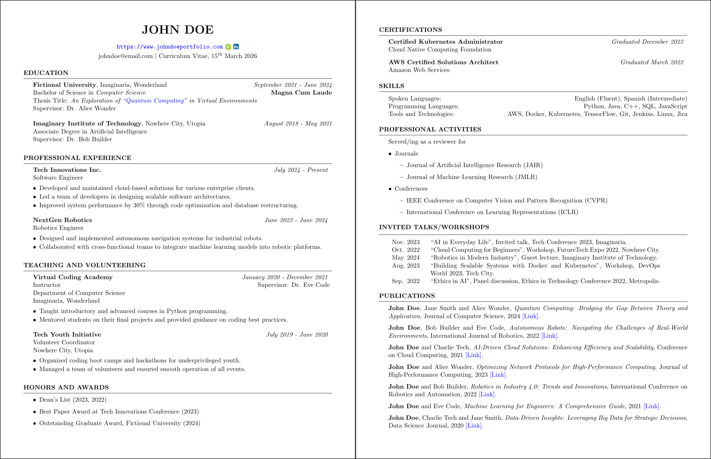

</div>

CV Tools turns a YAML file into a professional LaTeX CV. You write your details in YAML, keep your publications in a BibTeX file, and get a PDF.

# Build Status

| Tests                                                                        | Docker image                                                                         | Web app                                                                              |
| ---------------------------------------------------------------------------- | ------------------------------------------------------------------------------------ | ------------------------------------------------------------------------------------ |
|  |  |  |

# Table of Contents

- [Use It in Your Browser](#use-it-in-your-browser)
- [Getting Started](#getting-started)
- [YAML Configuration](#yaml-configuration)
- [Text Formatting](#text-formatting)
- [Editor Support](#editor-support)
- [BibTeX Configuration](#bibtex-configuration)
- [Migrating from v1](#migrating-from-v1)
- [Contributing](#contributing)

# Use It in Your Browser

Open [cv-tools.phonethk.com](https://cv-tools.phonethk.com/), edit the YAML and download the PDF. Nothing to install, just an up-to-date browser.

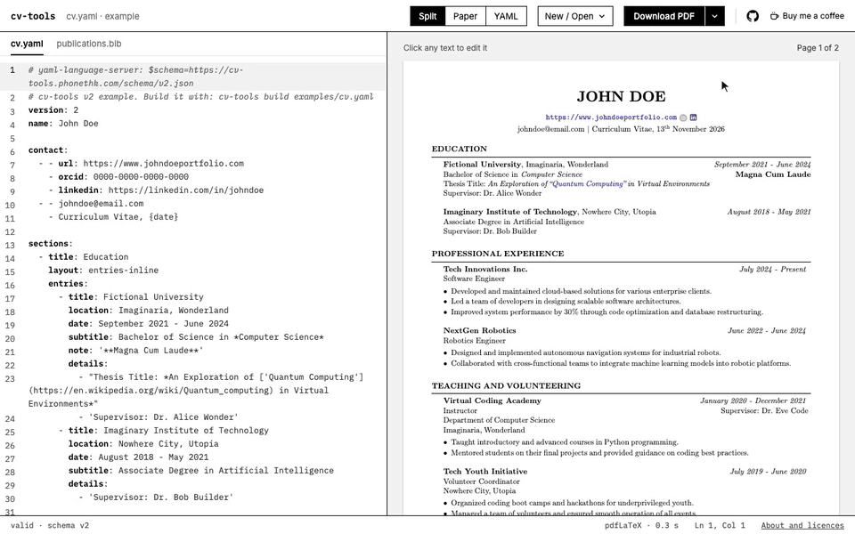

# Getting Started

## Installation

Install cv-tools with [pipx](https://pipx.pypa.io). It needs Python 3.10 or newer.

```bash
$ pipx install cv-tools-cli
```

## Usage

`cv-tools init` writes a starter `cv.yaml` and `publications.bib`. `cv-tools build` turns them into `cv.pdf`.

```bash
$ mkdir my-cv && cd my-cv
$ cv-tools init
$ cv-tools build cv.yaml
```

`cv-tools watch cv.yaml` rebuilds the PDF every time you save.

## Getting a PDF

`cv-tools build` needs pdflatex or Docker. Without either, you can still send your CV to Overleaf.

- **TeX Live**: Install [TeX Live](https://www.tug.org/texlive/). With a small installation such as BasicTeX, `cv-tools doctor --tlmgr` prints the command that installs the packages cv-tools needs.
- **Docker**: With Docker running, no TeX is needed. `cv-tools build` uses it when pdflatex or its packages are missing, or you can ask for it.

  ```bash
  $ cv-tools build cv.yaml --engine docker
  ```

- **Overleaf**: `cv-tools build cv.yaml --zip` writes `cv.zip`. Upload it to [Overleaf](https://www.overleaf.com) with New Project, then Upload Project.

## Commands

| Command                     | Description                                                   |
| --------------------------- | ------------------------------------------------------------- |
| `cv-tools init`             | Write a starter `cv.yaml` and `publications.bib`.             |
| `cv-tools build cv.yaml`    | Build the PDF. Add `--zip` or `--tex-only` for LaTeX sources. |
| `cv-tools watch cv.yaml`    | Rebuild the PDF every time you save.                          |
| `cv-tools validate cv.yaml` | Check the file and report errors with line numbers.           |
| `cv-tools migrate old.yaml` | Convert a v1 file to the new format.                          |
| `cv-tools doctor`           | Check that pdflatex, the TeX packages or Docker are ready.    |

# YAML Configuration

A CV file has a header and a list of sections. The complete example is [`examples/cv.yaml`](https://github.com/mlsdpk/cv-tools/blob/master/examples/cv.yaml).

## Header

| Key        | Type   | Description                                                                 | Required |
| ---------- | ------ | --------------------------------------------------------------------------- | -------- |
| `version`  | int    | Always `2`.                                                                 | Yes      |
| `name`     | string | Your name, printed as the page heading.                                     | Yes      |
| `contact`  | list   | Up to three lines under the name. Each line is a list of items.             | No       |
| `date`     | string | The text that `{date}` prints. The default `auto` prints the compile date. | No       |
| `sections` | list   | The sections of the CV, in order.                                           | No       |

A contact item is plain text or one of `url`, `orcid`, `linkedin`, `github` and `twitter`. Links print as links, and the others print as icons.

```yaml
version: 2
name: John Doe

contact:
  - - url: https://www.johndoeportfolio.com
    - orcid: 0000-0000-0000-0000
    - linkedin: https://linkedin.com/in/johndoe
  - - johndoe@email.com
    - Curriculum Vitae, {date}
```


## Sections

Every section has a `title` and a `layout`, and lists its rows under `entries`. An optional `description` adds a line of text under the heading. Keys mean the same thing in every layout, so nested points are always `bullets` and a row has a `title`, a `text` and a `date`.

| Layout                              | Use it for                                    |
| ----------------------------------- | --------------------------------------------- |
| [`entries`](#entries)               | Positions with a role, a date and bullets     |
| [`entries-inline`](#entries-inline) | A more compact version of `entries`           |
| [`list`](#list)                     | Bullet points, optionally with nested bullets |
| [`pairs`](#pairs)                   | A label on the left and text on the right     |
| [`dated`](#dated)                   | One line per item with a date in front        |
| [`text`](#text)                     | Paragraphs of free text                       |
| [`publications`](#publications)     | Entries of a BibTeX file                      |
| [`newpage`](#newpage)               | A page break                                  |

### `entries`

The `entries` layout lists positions, such as jobs or teaching.

| Field      | Type   | Description                                              | Required |
| ---------- | ------ | -------------------------------------------------------- | -------- |
| `title`    | string | The organisation, in bold.                               | Yes      |
| `location` | string | Printed after the title.                                 | No       |
| `date`     | string | Printed on the right of the first line.                  | No       |
| `subtitle` | string | The second line, for example your position.              | No       |
| `note`     | string | Printed on the right of the second line.                 | No       |
| `details`  | list   | Extra lines, such as a department or a city.             | No       |
| `bullets`  | list   | Bullet points.                                           | No       |

```yaml
- title: Teaching and Volunteering
  layout: entries
  entries:
    - title: Virtual Coding Academy
      date: January 2020 - December 2021
      subtitle: Instructor
      note: 'Supervisor: Dr. Eve Code'
      details:
        - Department of Computer Science
        - Imaginaria, Wonderland
      bullets:
        - Taught introductory and advanced courses in Python programming.
        - Mentored students on their final projects and provided guidance on coding best practices.
    - title: Tech Youth Initiative
      date: July 2019 - June 2020
      subtitle: Volunteer Coordinator
      details:
        - Nowhere City, Utopia
      bullets:
        - Organized coding boot camps and hackathons for underprivileged youth.
        - Managed a team of volunteers and ensured smooth operation of all events.
```

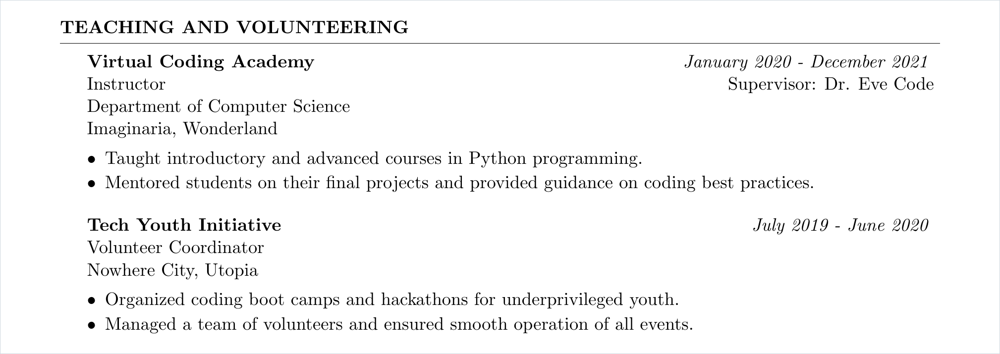

### `entries-inline`

The `entries-inline` layout takes the same fields as `entries` and prints them more compactly. It suits education.

```yaml
- title: Education
  layout: entries-inline
  entries:
    - title: Fictional University
      location: Imaginaria, Wonderland
      date: September 2021 - June 2024
      subtitle: Bachelor of Science in *Computer Science*
      note: '**Magna Cum Laude**'
      details:
        - "Thesis Title: *An Exploration of ['Quantum Computing'](https://en.wikipedia.org/wiki/Quantum_computing) in Virtual Environments*"
        - 'Supervisor: Dr. Alice Wonder'
    - title: Imaginary Institute of Technology
      location: Nowhere City, Utopia
      date: August 2018 - May 2021
      subtitle: Associate Degree in Artificial Intelligence
      details:
        - 'Supervisor: Dr. Bob Builder'
      bullets:
        - 'Relevant Coursework: Machine Learning, Advanced Algorithms'
```

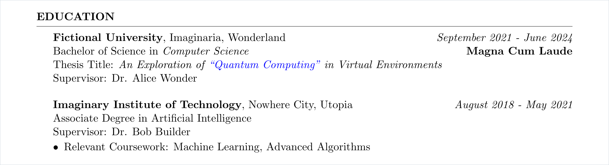

### `list`

The `list` layout prints bullet points. An entry is plain text, or a `text` with nested `bullets`.

| Field     | Type   | Description                      | Required |
| --------- | ------ | -------------------------------- | -------- |
| `text`    | string | The bullet point.                | Yes      |
| `bullets` | list   | Nested points under this bullet. | No       |

```yaml
- title: Honors and Awards
  layout: list
  entries:
    - Dean's List (2023, 2022)
    - Best Paper Award at Tech Innovations Conference (2023)
    - Outstanding Graduate Award, Fictional University (2024)

- title: Professional Activities
  layout: list
  description: Served/ing as a reviewer for
  entries:
    - text: Journals
      bullets:
        - Journal of Artificial Intelligence Research (JAIR)
        - Journal of Machine Learning Research (JMLR)
    - text: Conferences
      bullets:
        - IEEE Conference on Computer Vision and Pattern Recognition (CVPR)
        - International Conference on Learning Representations (ICLR)
```

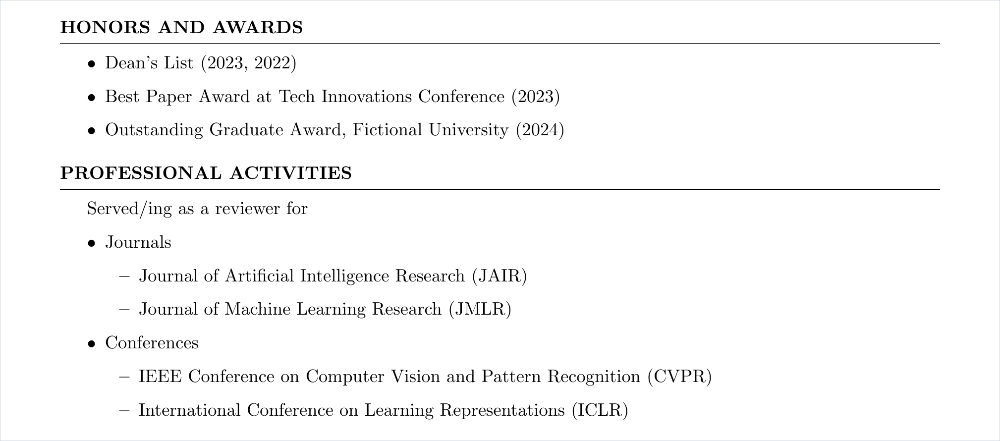

### `pairs`

The `pairs` layout prints a label on the left and its text on the right, useful for skills and languages.

| Field   | Type   | Description            | Required |
| ------- | ------ | ---------------------- | -------- |
| `title` | string | The label on the left. | Yes      |
| `text`  | string | The text on the right. | Yes      |

```yaml
- title: Skills
  layout: pairs
  entries:
    - title: Spoken Languages
      text: English (Fluent), Spanish (Intermediate)
    - title: Programming Languages
      text: Python, Java, C++, SQL, JavaScript
    - title: Tools and Technologies
      text: AWS, Docker, Kubernetes, TensorFlow, Git, Jenkins, Linux, Jira
```

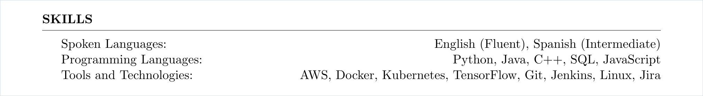

### `dated`

The `dated` layout prints one line per entry with the date in front.

| Field  | Type   | Description                    | Required |
| ------ | ------ | ------------------------------ | -------- |
| `date` | string | The date, such as `Nov. 2023`. | No       |
| `text` | string | The talk, event or item.       | Yes      |

```yaml
- title: Invited Talks/Workshops
  layout: dated
  entries:
    - date: Nov. 2023
      text: "'AI in Everyday Life', Invited talk, Tech Conference 2023, Imaginaria."
    - date: Oct. 2022
      text: "'Cloud Computing for Beginners', Workshop, FutureTech Expo 2022, Nowhere City."
    - date: May 2024
      text: "'Robotics in Modern Industry', Guest lecture, Imaginary Institute of Technology."
    - date: Aug. 2023
      text: "'Building Scalable Systems with Docker and Kubernetes', Workshop, DevOps World 2023, Tech City."
    - date: Sep. 2022
      text: "'Ethics in AI', Panel discussion, Ethics in Technology Conference 2022, Metropolis."
```

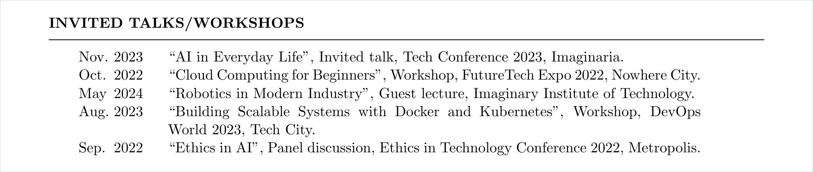

### `text`

The `text` layout prints one paragraph per entry, for a summary or a research statement.

| Field  | Type   | Description    | Required |
| ------ | ------ | -------------- | -------- |
| `text` | string | The paragraph. | Yes      |

```yaml
- title: Summary
  layout: text
  entries:
    - Software engineer with five years of experience in *cloud platforms* and *robotics*.
    - Interested in autonomous navigation, scalable systems and teaching programming to new developers.
```

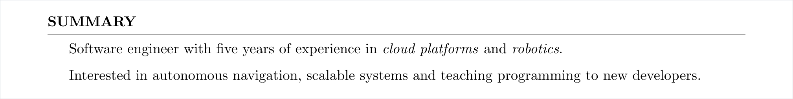

### `publications`

The `publications` layout lists the entries of a BibTeX file. It has no `entries`. See [BibTeX Configuration](#bibtex-configuration).

| Key         | Type   | Description                                                | Required |
| ----------- | ------ | ---------------------------------------------------------- | -------- |
| `bib`       | string | The `.bib` file, relative to the YAML file.                | Yes      |
| `highlight` | list   | Author names to print in bold. The default is your `name`. | No       |

```yaml
- title: Publications
  layout: publications
  bib: publications.bib
  highlight: [John Doe]
```

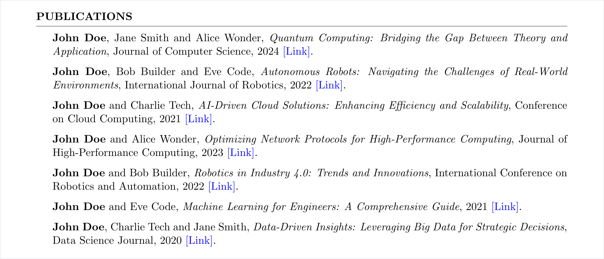

### `newpage`

The plain string `newpage` in the section list starts a new page.

```yaml
sections:
  - title: Honors and Awards
    layout: list
    entries:
      - Dean's List (2023, 2022)
      - Best Paper Award at Tech Innovations Conference (2023)

  - newpage

  - title: Certifications
    layout: entries
    entries:
      - title: Certified Kubernetes Administrator
        date: Graduated December 2023
        subtitle: Cloud Native Computing Foundation
```

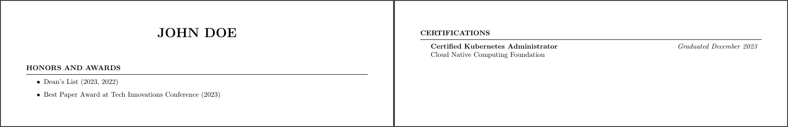

# Text Formatting

Every text field understands a small Markdown-like markup.

| Write                         | Result                                  |
| ----------------------------- | --------------------------------------- |
| `**Bold**`                    | **Bold**                                |
| `*Italic*`                    | *Italic*                                |
| `[My Portfolio](https://...)` | A link                                  |
| `"First line\nSecond line"`   | A line break                            |
| two spaces                    | A small space                           |
| four spaces or a tab          | A wider space                           |
| `'quoted phrase'`             | “quoted phrase” with LaTeX quotes       |
| `30% of R&D`                  | Printed as written, with no escaping    |
| `5\* rating`                  | 5\* rating, with a literal star         |
| `{latex: '\textsc{Name}'}`    | Raw LaTeX, inserted as it is            |

Accented letters, Greek letters and common math symbols print as they are. See [the full list of supported characters](https://github.com/mlsdpk/cv-tools/blob/master/src/cv_tools/templates/latex/unicode.txt).

```yaml
- title: Text Formatting
  layout: list
  entries:
    - "**Bold**, *italic* and ***bold italic*** text"
    - "A [link to my portfolio](https://www.johndoeportfolio.com)"
    - "A 'quoted phrase' becomes LaTeX quotes"
    - "First line\nSecond line"
    - "Two  spaces and four    spaces"
    - "LaTeX specials print as written: 30% & $5 for #1 in C_1"
    - "Literal escapes: 5\\* rating and \\[not a link\\](x)"
    - "Unicode: café, naïve, α ≤ β, x → ∞"
    - {latex: "Raw \\LaTeX: \\textsc{Small Caps}"}
```

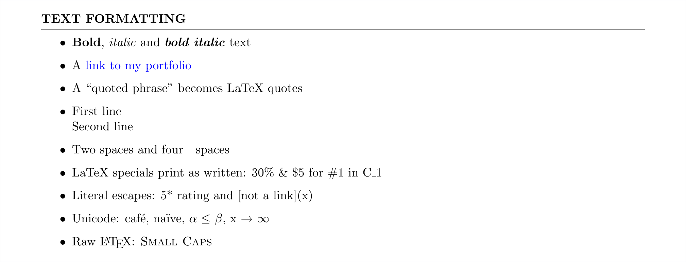

# Editor Support

Files from `cv-tools init` start with a schema comment. With the [YAML extension for VS Code](https://marketplace.visualstudio.com/items?itemName=redhat.vscode-yaml), it gives autocompletion and shows errors as you type.

```yaml
# yaml-language-server: $schema=https://cv-tools.phonethk.com/schema/v2.json
```

`cv-tools validate cv.yaml` checks a file and reports errors with line numbers.

# BibTeX Configuration

Keep your publications in a BibTeX file and add a `publications` section that points to it with `bib`.

```bibtex
@article{doe2024quantum,
  author = {John Doe and Jane Smith and Alice Wonder},
  title = {Quantum Computing: Bridging the Gap Between Theory and Application},
  journal = {Journal of Computer Science},
  year = {2024},
  url = {https://example.com/quantum-computing-paper}
}
```

> cv-tools prints your name in bold in the author list. Set `highlight` in the section to bold other names.

> Most BibTeX entries have no `url` field. cv-tools adds a [Link] only when the entry has one, so add the field by hand where you want the link.

Publications appear in the order of the `.bib` file. An example BibTeX file is provided [here](https://github.com/mlsdpk/cv-tools/blob/master/examples/publications.bib).

# Migrating from v1

v1 files (with `heading`, `subheading` and `type:` sections) still build, with a deprecation warning. Support for them will be removed in a future release. Convert your file once and keep the new one.

```bash
$ cv-tools migrate old.yaml -o cv.yaml
$ cv-tools build cv.yaml
```

The new file gives the same PDF.

| v1                                                  | v2                                    |
| --------------------------------------------------- | ------------------------------------- |
| `heading: {name: ...}`                              | `name`                                |
| `subheading` with `links` and `socials`             | `contact`                             |
| `type: education`                                   | `layout: entries-inline`              |
| `type: experience`                                  | `layout: entries`                     |
| `type: bullets` with `item`, `subitems`             | `layout: list` with `text`, `bullets` |
| `type: skills` with `name`, `data`                  | `layout: pairs` with `title`, `text`  |
| `type: talks` with `name`, `month`, `year`          | `layout: dated` with `text`, `date`   |
| `type: publications` with `bibfile`                 | `layout: publications` with `bib`     |
| `type: newpage`                                     | `newpage`                             |
| `content`                                           | `entries`                             |
| `university`, `organization`                        | `title`                               |
| `degree`, `position`                                | `subtitle`                            |
| `dates`                                             | `date`                                |
| `responsibilities`                                  | `bullets`                             |

A few small fixes change the PDF of some v1 files. See the [CHANGELOG](https://github.com/mlsdpk/cv-tools/blob/master/CHANGELOG.md).

`run.sh` still works but is deprecated. Use `cv-tools build` instead.

# Contributing

Feel free to contribute to this project by submitting issues or pull requests. Contributions are welcome to improve the templates, add new features, or fix bugs.

- Python tests run with `pytest` after `pip install -e '.[test]'`.
- Web app tests run with `npm --prefix web test`.

# Acknowledgments

The LaTeX template currently supported in this project is based on the **Medium Length Professional CV** template from [LaTeXTemplates.com](https://www.latextemplates.com/template/medium-length-professional-cv), which has been extensively modified for this project. The original template was created by [Trey Hunner](https://treyhunner.com).

# License

This project is licensed under the [MIT License](https://opensource.org/license/mit).
